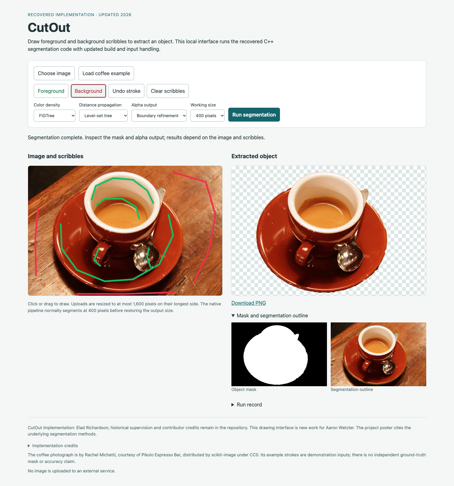

# CutOut

CutOut extracts an object mask and transparent image from foreground/background scribbles. It combines colour-density estimates with image-distance propagation and optional alpha refinement.

Original project: **Elad Richardson**. Supervision: **Anastasia Dubrovina and Aaron Wetzler**.

*Actual updated macOS desktop drawing interface using the credited coffee photograph; no reference segmentation is available.*

The recovered Android source is preserved unchanged. Updated C++/OpenCV code fixes documented numerical and memory issues and supports new browser, Android, iOS, macOS and Linux interfaces. The original Eclipse interface remains unbuilt.

## Updated

**[Open the browser demo](https://twerdster.github.io/cutout-android/)** · [Updated guide](updated/README.md)

The browser app runs the C++17 port of the recovered algorithms in WebAssembly. Load a photograph, mark foreground/background, run segmentation and download a mask or transparent PNG. Images stay in the page and are scaled so the longer side is at most 1,000 pixels. Chrome desktop/phone-width checks passed; physical phone browsers and other browsers remain untested.

[Browser setup](updated/browser/README.md) · [Android](updated/android/README.md) · [iOS](updated/ios/README.md) · [macOS/Linux](updated/native/README.md) · [Validation](docs/VALIDATION.md)

## Project record and rights

[Historical context, attribution and recovery details](PROJECT_RECORD.md) preserve the earlier record. Original material, datasets, dependencies and new code keep their separately stated terms; no blanket license is added.
