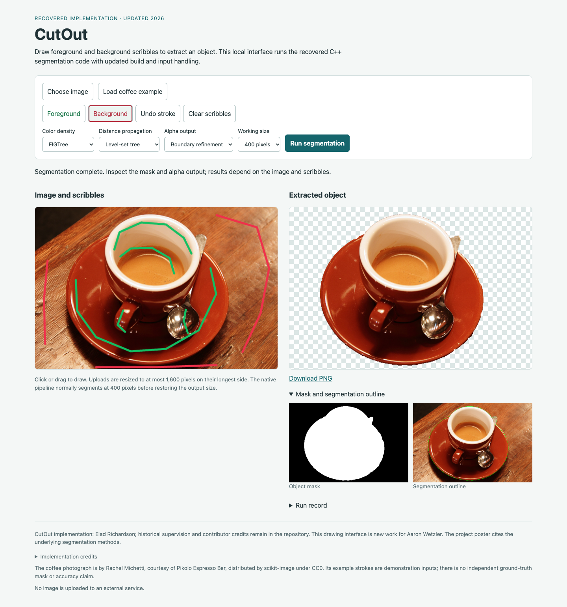

# CutOut

CutOut extracts an object mask and transparent PNG from an image and foreground/background scribbles. The updated C++ implementation uses the recovered Lab color-density, pixel-grid Dijkstra and level-set-tree operators, with documented fixes and new interfaces.

Original project: Elad Richardson, supervised by Anastasia Dubrovina and Aaron Wetzler. Original source and notices are preserved; updated code is kept separately under `updated/`.



*An actual desktop run using FIGTree, tree propagation and refined alpha. The CC0 photograph and demonstration strokes are documented in the [fixture guide](updated/validation/fixtures/README.md); this example has no reference segmentation.*

## Run on macOS or Linux

Install CMake 3.22+, Ninja, a C++17 compiler and OpenCV 4 development files (`core`, `imgproc`, `imgcodecs`). The drawing interface also requires Python 3.10+. See the [native guide](updated/native/README.md) for dependency setup and CLI options.

From the repository root:

```sh
cmake -S updated/native -B build/native -G Ninja \
  -DCMAKE_BUILD_TYPE=Release
cmake --build build/native --parallel 2
python3 updated/desktop/server.py --binary build/native/cutout_cli
```

If CMake cannot find OpenCV, select its installation as described in the native guide. Open <http://127.0.0.1:8768/>, load an image, draw both seed classes and run segmentation. Download the transparent PNG from the result. Processing stays local.

## Platform guides

| Interface | Build and usage |
| --- | --- |
| Android | [Android app](updated/android/README.md) |
| iOS | [iOS app](updated/ios/README.md) |
| macOS / Linux | [Native CLI](updated/native/README.md) · [Drawing interface](updated/desktop/README.md) |

The separate [Python fast-marching exercise and notebook](updated/README.md) uses a procedural image; it does not implement the recovered Android operator chain.

## Source and documentation

- [Original Android snapshot](source/original/android-app/) and [source/build notes](docs/original-android.md). The historical Eclipse interface remains unbuilt.
- [Project summary](docs/summary.pdf) and [poster](docs/poster.pdf).
- [Validation and limitations](docs/VALIDATION.md), with platform records and known output artifacts.
- [Attribution and terms](docs/ATTRIBUTION.md), [source manifests](source/ANDROID_PROVENANCE.json) and [third-party licenses](docs/licenses/README.md). No blanket repository license is assigned.

[Project website](https://twerdster.github.io/#cutout-for-android) · [Original project page](https://gip.cs.technion.ac.il/last-projects-2015-1.html) · [Elad Richardson](https://eladrich.github.io/)
