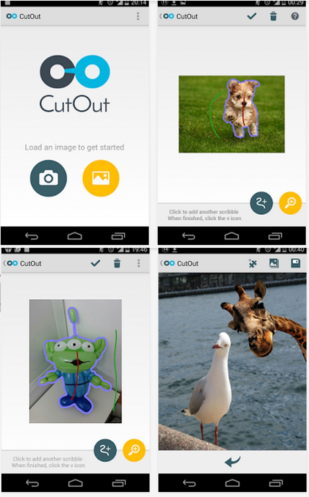

# Original Android implementation

Elad Richardson supplied the Android archive on 2026-11-13, identifying it as the version used in the application and pointing to `jni/jni_part.cpp`, particularly `DoKernelEstimation`. He also authorized hosting recovered project code. The [snapshot](../source/original/android-app/) preserves all 319 regular files unchanged, including historical build paths, resources and notices. The [manifest](../source/ANDROID_PROVENANCE.json) records the incoming ZIP hash and each published file's hash. Empty archive directories are not represented in Git.

The unchanged original Eclipse application has not been built, packaged or executed. The initial recovery covered source preservation and inspection, without an image-quality/runtime benchmark. The separate [Python exercise](../updated/README.md) predates this recovery and implements a limited synthetic example rather than this application's operator chain.

The [updated native implementation](../updated/native/README.md) adapts these recovered C++ operators for separate platform interfaces. Its [validation records](VALIDATION.md) apply to updated code; the original Eclipse application and this snapshot remain unchanged and unbuilt.

Read-only checks covered all text/XML files and available image metadata. Raster content was reviewed through a contact sheet and four individual tutorial screenshots. No privacy-based file exclusions or redactions were needed.

*Unchanged historical project imagery from the archived website; this is not an updated-platform validation result.*

## Read the source

Paths in this section are relative to `source/original/android-app/`.

- [`src/com/eladrich/scribbler/MainActivity.java`](../source/original/android-app/src/com/eladrich/scribbler/MainActivity.java) converts the image and foreground/background scribbles to OpenCV matrices and passes their native addresses to JNI.
- [`jni/jni_part.cpp`](../source/original/android-app/jni/jni_part.cpp), `DoKernelEstimation`, converts BGRA input to floating BGR. For images whose longest side exceeds 400 pixels, it reduces the image before segmentation, then enlarges, rounds and smooths the mask. It draws the mask's contours for display.
- [`jni/KernelEstimation.cpp`](../source/original/android-app/jni/KernelEstimation.cpp), `updateObjectMask`, fills scribble paths, updates foreground/background color densities, calculates relative likelihoods, propagates distances from the scribbles and compares those distances to form an object mask. Subsequent operations can add foreground or background scribbles.
- Color density estimation uses Lab colors and FIGTree by default. Disabling the FIGTree preference selects a discretized Lab histogram with Gaussian smoothing. This preference is independent of the distance-propagation preference.
- With level-set mode off, the code runs four-neighbor pixel-grid Dijkstra from each seed set using the foreground likelihood image for both runs. Each edge increment is the absolute difference between neighboring weights plus `1e-5`. With level-set mode on, it builds a tree from that same foreground likelihood image using MegaWave2's Fast Level Sets Transform (`flst`), computes distances from both seed sets on the tree and maps them back to pixels. Tree edge increments use the absolute difference between parent/child shape values. These are source-inspected operations, not a claim of equivalence to a paper's full method.
- `DoAlphaFromMask` in `jni_part.cpp` refines alpha in a boundary band, combines the color and alpha channels, and crops the result. Other JNI operations implement foreground/background blur and grayscale editing.

The recovered preferences enable FIGTree and disable level-set mode by default. Elad described the archive as containing Bai and level-set algorithms. The original [poster](poster.pdf) cites Bai and Sapiro's *A Geodesic Framework for Fast Interactive Image and Video Segmentation and Matting* and Dubrovina, Hershkovitz and Kimmel's *Image Editing Using Level Set Trees*. Those references provide historical method context; this inspection does not establish exact reproduction of either publication.

## Build records and missing dependencies

The snapshot is an Eclipse ADT/CDT Android project using `ndk-build`, not a Gradle project. It references dependencies outside the archive:

| Record | Inspected requirement or limitation |
| --- | --- |
| `project.properties` | Android build target `android-19`; OpenCV 2.4.9 Java SDK; sibling `android-multitouch-controller/MTController` |
| `jni/Android.mk` | OpenCV 2.4.9 native SDK through a historical absolute path; ANN, FIGTree and application native modules |
| `jni/Application.mk` | `gnustl_static`, RTTI/exceptions, `APP_ABI := all`, native platform `android-8` |
| `AndroidManifest.xml` | App version `1.2.3`, minimum SDK 14, target SDK 18; camera and external-storage permissions |
| `.project` / `.classpath` | Eclipse Android/CDT builders, `${NDKROOT}/ndk-build`, generated-source and ADT containers |

The OpenCV SDK and multitouch-controller dependency trees are not included. The archive contains no Android APK, Gradle wrapper, Ant `build.xml`, generated Java sources or bundled JARs. FIGTree is declared as a shared library but later listed under `LOCAL_STATIC_LIBRARIES`; this is an unresolved build-configuration inconsistency, not a recorded build failure. The manifest target, project build target and native platform are different records and should not be collapsed into one tested SDK version.

Rebuilding the unchanged Eclipse application would need a documented dependency/toolchain selection, local path changes and resolution of its native linkage configuration. Put such changes in a separately labeled updated implementation; keep this snapshot unchanged. No verified installation procedure is supplied for that historical interface. The later updated runtime has its own build commands and validation records linked above.

## Attribution and terms

The historical summary/poster credit Elad Richardson, supervised by Anastasia Dubrovina and Aaron Wetzler. The recovered About text credits Elad Richardson, Anastasia Dubrovina and Ron Kimmel, lists Aaron Wetzler for additional technical supervision, and says the interface and logo were designed with Michal Hendel's help. Its original text is preserved in `res/values/strings.xml`.

The archive combines project code and third-party material:

- ANN credits Sunil Arya, David Mount and the University of Maryland and carries LGPL notices. Its referenced readme/license files were absent from this archive. The upstream ANN license and copyright references are supplied separately.
- FIGTree credits Vlad Morariu, Vikas Raykar and Changjiang Yang and specifies LGPL 2.1 or later.
- MegaWave2 system files credit Jacques Froment and Sylvain Parrino; `flst` credits Pascal Monasse. MegaWave2 is from CMLA, Ecole Normale Superieure de Cachan, 61 avenue du President Wilson, 94235 Cachan cedex, France. The archive contained source notices but no standalone terms. A separately sourced MegaWave2 public license and copyright reference is included; it is not a new license assigned to CutOut. The supplementary MegaWave2 terms call for module-author and laboratory attribution in derivative programs and reports.
- `PhotoDragView.java` and `PhotoSortrView.java` retain Luke Hutchison's MIT notice. `Exif.java` retains the Android Open Source Project's Apache 2.0 notice. `ZoomView.java` retains its `karooolek` author annotation without an additional standalone grant in the received file.

See [supplementary license references](licenses/README.md) for exact sources and hashes. They were added outside the unchanged snapshot. Elad Richardson's permission to host recovered project code is his permission only and does not speak for other credited contributors. It does not replace individual notices, settle third-party permission questions, establish authorship of the older three-file prototype, or grant consent to a new manuscript. No blanket repository license is assigned.
