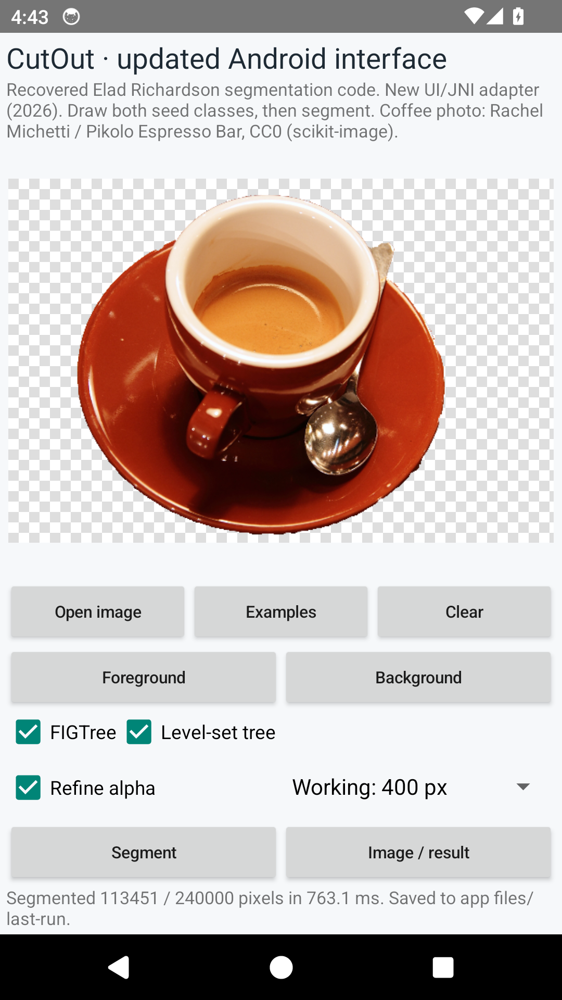

# CutOut for Android

This Android interface loads a photograph, accepts foreground/background scribbles and runs the restored native CutOut operators locally. FIGTree or histogram color density, pixel-grid or level-set-tree propagation, and hard or refined alpha can be selected independently. The interface and JNI adapter are updated 2026 work; Elad Richardson's recovered implementation and the [original Eclipse application](../../source/original/android-app/) remain separately preserved.

<p></p>

*Actual Android emulator screenshot with FIGTree, level-set propagation, refined alpha and a 400-pixel working limit. Photograph: Rachel Michetti / Pikolo Espresso Bar, CC0 via scikit-image; no independent reference mask.*

## Requirements and build

The build targets ARM64 Android devices or emulators and declares Android 8.0/API 26 as its minimum. Select JDK 17 or 21 for the Gradle build. The project uses Gradle 8.7 through the included wrapper, Android Gradle Plugin 8.3.0, SDK/build tools 34, NDK 27.2.12479018, CMake 3.22.1 and OpenCV Android SDK 4.12.0. The APK currently contains `arm64-v8a` only.

Install [Android Studio or Google's command-line tools](https://developer.android.com/studio), configure `ANDROID_HOME` for that SDK, and accept its package licenses. With `sdkmanager` on your path:

```sh
sdkmanager 'platform-tools' 'platforms;android-34' 'build-tools;34.0.0' \
  'ndk;27.2.12479018' 'cmake;3.22.1'
```

Download `opencv-4.12.0-android-sdk.zip` from the [official OpenCV release](https://github.com/opencv/opencv/releases/tag/4.12.0), verify SHA-256 `fd7f2332331b4eb8b67e55137281cfb16823c9399d90deb9cfa3476783b99e35`, and extract it. Set `OPENCV_ANDROID_SDK` to its `OpenCV-android-sdk` directory, or pass the equivalent `-PopencvSdk=...` Gradle property.

From the repository root:

```sh
cd updated/android
export OPENCV_ANDROID_SDK=/path/to/OpenCV-android-sdk
./gradlew --no-daemon --max-workers=2 assembleDebug
adb install -r app/build/outputs/apk/debug/app-debug.apk
adb shell am start -n org.awetzler.cutout.updated/.MainActivity
```

Android Studio can also open `updated/android` and build/run the app with the same dependencies. The local debug APK is not a signed store release. The [Android Java requirements](https://developer.android.com/build/jdks) and [SDK/NDK configuration guide](https://developer.android.com/studio/projects/configure-agp-ndk) explain the toolchain settings.

## Use

Open an image, draw green foreground and red background scribbles, then select **Segment**. Drawing one class erases overlapping pixels from the other. **Image / result** switches between the input and the cutout on a checkerboard. **Examples** loads an ellipse or the bundled coffee photograph with supplied scribbles. **Clear** removes both classes; **Credits and terms** shows implementation and dependency notices.

Imported images are oriented using Exif and reduced to at most 800 pixels along their longest side. Segmentation uses a separate 400-pixel working limit by default. Choose 800 pixels or **Working: full input** when reduction merges nearby opposing scribbles; full-resolution processing takes more time. Changing an image, scribble or option invalidates the old preview. Processing runs on one background worker and requires no network service. The app requests no Internet, camera or broad storage permission.

The latest saved run contains `input.png`, `foreground.png`, `background.png`, `mask.png`, `cutout.png` and `result.json` in the app-specific `files/last-run` directory. The mask is binary; optional refinement changes `cutout.png` alpha. JSON records selected operators, dimensions, foreground-pixel count and elapsed segmentation/JNI milliseconds. `result.json` is written last and marks a complete saved run. A storage failure is reported separately while a successfully computed result remains visible; partial PNGs without the completion marker are not a complete run.

The original camera, tutorial, multitouch composition, blur and grayscale interfaces are not recreated here. The native guide describes [operator changes and limits](../native/README.md#operator-choices-and-changed-behavior).

## Validation

[VALIDATION.json](VALIDATION.json) records build/lint, Android 14 emulator checks and a separate physical Android 10 run, including 14 Activity/JNI segmentation cases, supplied seed checks and six hard/refined mask-pair comparisons. UI, gallery, persistence and diagnostic coverage differ between those environments. The declared API 26 minimum is not a recorded runtime test. These checks do not measure photographic accuracy or establish identical results on every Android device.

From `updated/android`, for an explicitly selected, authorized device or emulator, the optional integration helper runs the same 14 fixture cases:

```sh
python3 tools/smoke.py --serial DEVICE_SERIAL --output build/android-smoke
```

Use the serial from `adb devices`. The helper restarts this app and replaces its generated `files/last-run` outputs, so retain any outputs you need first. It saves PNG/JSON/log evidence locally and captures screenshots only while CutOut is foreground. Review personal-device screenshots before sharing them. A completed launch by itself is not evidence that segmentation ran.

## Attribution and dependencies

The native implementation, fixes and original project credits are described in the [native guide](../native/README.md), [original implementation guide](../../docs/original-android.md) and [supplementary license references](../../docs/licenses/README.md). The build packages the selected OpenCV SDK's notices, ANN/FIGTree/MegaWave references, Gradle wrapper notices and fixture credit. [Gradle's license](gradle/LICENSE) and [notice](gradle/NOTICE) remain unchanged. No blanket license is assigned to this mixed archive or the recovered project.
