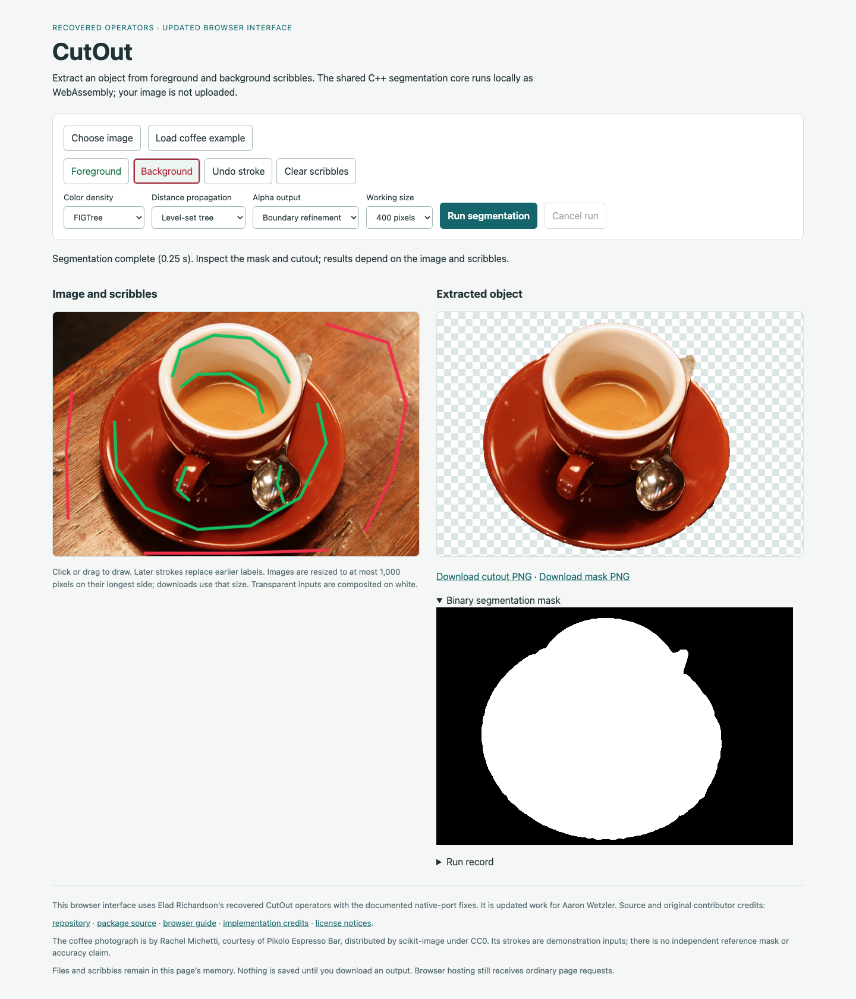

# CutOut in the browser (updated 2026)

This interface compiles the shared [updated C++ core](../native/README.md) to WebAssembly. Images and scribbles remain in your browser; segmentation runs in a Web Worker on your device. There is no image-upload endpoint or remote inference service.

Open the [browser app](https://twerdster.github.io/cutout-android/), load the coffee example or choose an image, mark foreground in green and background in red, and run segmentation. Later strokes replace earlier labels where they cross. Download the transparent cutout or binary mask as PNG. Editing inputs invalidates the previous result; Cancel discards a running worker.

The controls select the native core’s density (Lab histogram or FIGTree), distance (pixel Dijkstra or level-set tree) and optional boundary alpha refinement. This is a new browser interface around the recovered operators, not the original Android interface or the separate Python exercise. Results depend on the image and scribbles. The example photograph has no reference mask.



*Actual Chrome execution with FIGTree, level-set-tree distance and boundary refinement. The photograph and demonstration strokes are credited below; this is not an accuracy benchmark.*

## Limits

Use a current browser with WebAssembly, Web Workers, Canvas and Pointer Events. Input files are limited to 20 MB and 40 million decoded pixels; the app resizes them to at most 1,000 pixels on the longest side. Outputs have those resized dimensions. The working grid is at most 400 or 800 pixels on its longest side. Large seed sets, tree propagation and refined alpha can take longer or exhaust browser memory, especially on phones. Cancel and try a smaller image or simpler options if necessary. Physical Android/iOS browser execution has not been recorded.

The browser decodes images and rasterizes strokes; those steps can differ from native image codecs and OpenCV drawing. WebAssembly and native builds can also differ numerically. The [validation record](VALIDATION.json) names tested operators, fixtures and comparison tolerances; it does not establish general numerical equivalence or photographic accuracy.

## Rebuild and serve

Install CMake 3.22+, Ninja, Python 3.10+ and the [Emscripten SDK](https://emscripten.org/docs/getting_started/downloads.html). Activate Emscripten **4.0.20** in the current shell. Obtain and verify the official **OpenCV 4.12.0** source using the archive URL and SHA-256 in the [source-build guide](../native/BUILDING_OPENCV.md). Activate the SDK in the build shell rather than changing system-wide settings.

From the repository root:

```sh
bash updated/browser/build.sh path/to/opencv-4.12.0 build/browser
python3 -m http.server 8774 --bind 127.0.0.1 --directory build/browser/site
```

Open <http://127.0.0.1:8774/>. The package must be served over HTTP(S); opening `index.html` with a `file:` URL is not supported. `build/browser/site` is a standalone static site with the Wasm binary, interface, example and required credit/license files. Build tools run on macOS/Linux; [recorded environments and results](VALIDATION.json) distinguish completed checks from setup instructions.

The [Pages workflow](../../.github/workflows/browser-pages.yml) rebuilds the package, compares native and Wasm core outputs, and checks the drawing interface before deployment. Its Ubuntu native comparison uses the distribution’s OpenCV 4.6.0, while the Wasm build uses 4.12.0; that comparison includes library-version differences. The recorded local comparison uses 4.12.0 for both. Generated Wasm files are deployment artifacts rather than committed source.

## Reproduce the checks

The core comparison requires Pillow and a native OpenCV 4 development installation in addition to the build tools:

```sh
cmake -S updated/browser -B build/browser-reference -G Ninja -DCMAKE_BUILD_TYPE=Release
cmake --build build/browser-reference --parallel 2
python3 updated/browser/tests/check_core.py --native build/browser-reference/cutout_bridge_reference \
  --wasm-js build/browser/core/cutout_wasm.js --output build/browser-comparison
```

It checks all eight density/distance/alpha combinations on a generated ellipse and the pinned photograph, plus expected input errors. It compares identical raw RGBA and label arrays, excluding browser decoding and stroke rasterization. Masks must have intersection-over-union at least `0.995` against the named native build; the report retains actual differences and alpha byte errors. This is a compatibility check, not a segmentation accuracy score.

With the static server running, install the isolated browser-test tool and its Chromium browser, then run the interface checks:

```sh
npm install --prefix build/browser-test-tools playwright@1.62.1
build/browser-test-tools/node_modules/.bin/playwright install chromium
NODE_PATH="$PWD/build/browser-test-tools/node_modules" \
  node updated/browser/tests/check_browser.cjs http://127.0.0.1:8774/ build/browser-qa
```

These automated checks launch a separate test browser. They cover the example operator choices, image upload, pointer strokes, undo/clear, output invalidation, cancellation/recovery, downloads and narrow/wide layouts.

## Attribution

Recovered CutOut implementation: Elad Richardson. Historical supervision and contributor credits remain in [attribution and terms](../../docs/ATTRIBUTION.md). The browser bridge, worker, drawing adaptation and packaging are updated 2026 work by Codex for Aaron Wetzler. Native FIGTree, ANN, MegaWave2/FLST and OpenCV notices accompany the package; no blanket repository license is assigned. The CC0 coffee image is by Rachel Michetti, courtesy of Pikolo Espresso Bar, via scikit-image; [fixture provenance](../validation/fixtures/README.md) records its source and the new demonstration strokes.
